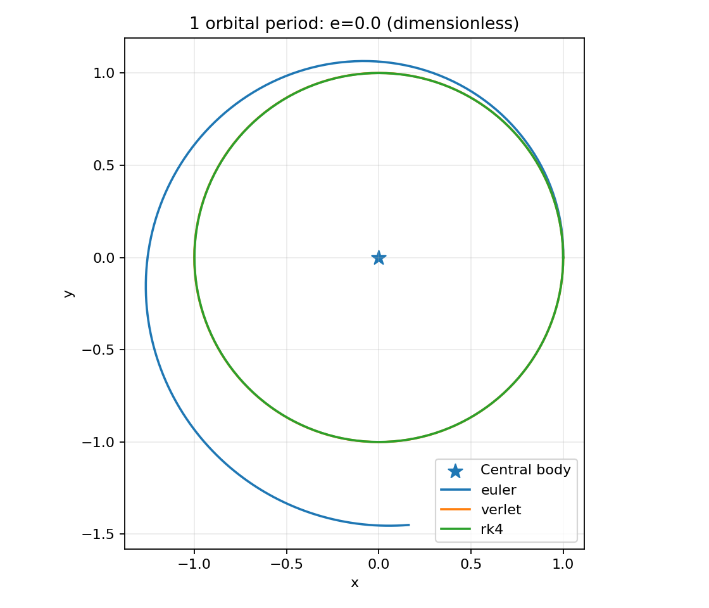
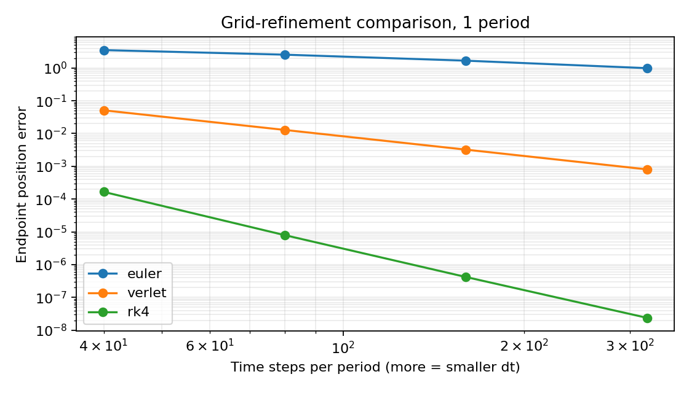

# P08 · Orbital Numerics Lab

**English:** Compare explicit Euler, velocity Verlet, and RK4 on a dimensionless Kepler two-body orbit. **한국어:** 궤도 역학 수치적분기 비교 실험.

## Question
Does a numerically more accurate integrator also conserve physical invariants in a short Kepler orbit simulation?

## Model

A test particle moves in a fixed inverse-square central field (gravitational parameter μ=1). In normalized units, a circular orbit starts at position (1,0), velocity (0,1), with period 2π.

```text
acceleration a(r) = - μ r / |r|^3
specific energy E = |v|^2/2 - μ/|r|
angular momentum h = x*vy - y*vx
```

## Components
- `orbitlab/physics.py`: acceleration, conserved quantities, initial conditions, Euler/Verlet/RK4
- `orbitlab/run.py`: one-period method comparison and grid-refinement study
- `tests/`: 18 unit tests, including reversibility and energy/AM consistency
- `artifacts/`: orbit plot, convergence plot, CSV, JSON
- `docs/KO_BEGINNER_TO_INTERVIEW.md`: Korean undergraduate beginner tutorial + 20 interview Q&A
- `publishing/`: English article and social drafts

## Reproduce locally

```bash
python -m pip install -r requirements.txt
python -m unittest discover -s tests -v
python -m orbitlab.run
python -m orbitlab.run --eccentricity 0.4 --out artifacts/eccentric
```

Tested with Python 3.13.5 and Matplotlib 3.10.8. No real orbital observations or mission data were used.

## Verified result — circular orbit, 160 steps over one period

| Method | Maximum relative energy drift | Endpoint position error |
|---|---:|---:|
| Euler | 2.6485×10⁻¹ | 1.6745 |
| Velocity Verlet | 5.9317×10⁻⁷ | 0.0032279 |
| RK4 | 1.6305×10⁻⁸ | 4.1917×10⁻⁷ |

The higher-order RK4 has smaller short-horizon error *for these conditions*. Verlet is symplectic and reversible; whether it offers long-run advantages must be evaluated over much longer integrations, rather than inferred solely from one period.




## Limitations
No realistic units, multi-body interactions, spacecraft propulsion, atmospheric drag, J2, relativity, adaptive stepping, orbital elements fit, observational ground truth or mission safety validation. A single orbit does not establish all long-time symplectic properties.

## References
- Rutgers computational physics notes: https://www.physics.rutgers.edu/~haule/ComputationalPhysics/Numerical_Error.html
- University of Illinois symplectic method educational resource: https://heath.cs.illinois.edu/iem/ode/symplectic/
